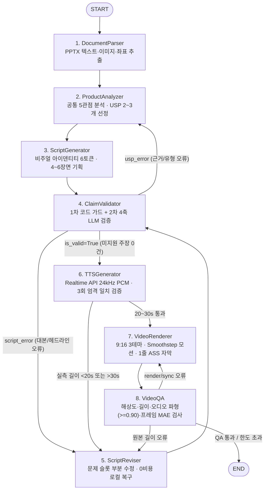
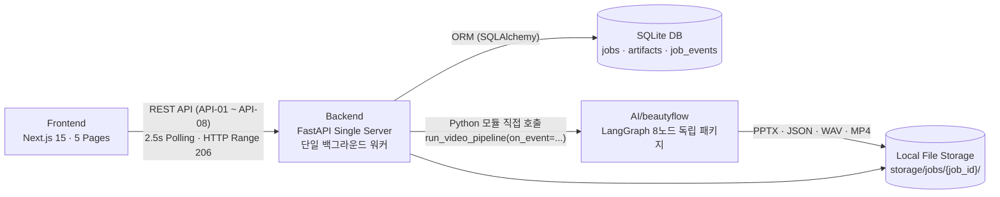

# BeautyFlow

**화장품 상세페이지(PPTX)에서 핵심 특장점(USP)을 분석하고, 원문 기반 팩트체크와 자동 품질 검증을 거쳐 20~30초 분량의 9:16 영문 숏폼 영상(MP4)을 자동 생성하는 멀티모달 LangGraph AI Agent 시스템**

---

## 1. 프로젝트 개요 및 핵심 성과

화장품 마케팅 숏폼 영상 제작은 상세페이지 분석, 카피라이팅, 규제·과장광고 검수, 내레이션 녹음, 영상 편집까지 수작업 비용이 크며, 일반 생성형 AI를 그대로 적용할 경우 **원문에 없는 효능·임상·SPF 수치를 지어내는 환각(Hallucination)**과 **영상 길이·자막·오디오 싱크 이탈** 문제가 발생합니다.

BeautyFlow는 이를 해결하기 위해 **문서 파싱 → 멀티모달 제품 분석 → 스토리보드 기획 → 2단계 팩트체크 → 부분 수정 → 실시간 TTS → FFmpeg 렌더링 → 멀티모달 QA**를 **8개 LangGraph 노드와 조건부 자동 복구 루프**로 설계하고, **4종 정량 평가 체계(LangSmith · AgentEvals · Pytest · VLM Judge)**와 **FastAPI + SQLite + Next.js 웹 서비스**까지 End-to-End로 구현했습니다.

| 핵심 항목 | 검증 결과 (v2.3) | 비고 |
| :--- | :--- | :--- |
| **원문 외 미지원 주장 (Hallucination)** | **0건** | 1차 Python 코드 가드 + 2차 4축 LLM 의미 검증 |
| **영상 규격 준수율** | **100%** | `1080×1920 (9:16)`, `20~30초`, 1줄 자막, 오디오 싱크 `1.000` |
| **카테고리 범용성** | **하드코딩 0건** | 쿠션(`LUMIA`) · 선세럼(`SOLAIA`) · 크림(`DERMERA`) 동일 파이프라인 |
| **경로·복구 분기 정확도 (`AgentEvals`)** | **In-Order 100% / Handoff 100% (6/6)** | 6대 오류 유도 시나리오 자동 차단·복구 |
| **멀티모달 VLM Judge 품질 평가** | **4.20 / 5.00** (사실성 전 제품 **5/5**) | v1 vs v2.3 블라인드 A/B 비교 **`v2` 승리** |
| **자동화 테스트 (CI 오프라인 + 통합)** | **AI 114건 + Backend 4건 100% 통과** | GitHub Actions Windows/Python 3.11 CI 연동 |
| **운영 효율 (Golden 3종 평균)** | **146.8초 / `$0.0255` (편당)** | `gpt-6-luna` + `gpt-realtime-2.1-mini` 기준 |

---

## 2. 설계 원칙 및 가드레일

1. **원문 근거 기반 사실성 보장 (Zero Unsupported Claims)**
   - 원본 PPTX에 없는 효능·임상 수치·SPF/PA·의약품 오인 표현을 차단하며, `look`, `feel`, `appearance`, `helps`, `designed to` 같은 완화 표현의 강도를 유지합니다.
   - 성분명이 완제품 효능의 주어로 과장되지 않도록 성분 경계 규칙을 프롬프트와 검증기 양쪽에 강제합니다.
2. **카테고리 하드코딩 금지**
   - 특정 화장품(쿠션 등)에 종속된 `if` 분기를 배제하고, 모든 화장품에 공통 적용되는 **5가지 제품 분석 관점**과 **3가지 USP 유형(`result_finish`, `texture_feel`, `functional_benefit`)**, **6종 비주얼 아이덴티티 토큰**으로 범용 동작하도록 설계했습니다.
3. **외부 크롤링 금지 및 출력 규격 고정**
   - 외부 쇼핑몰 크롤링을 금지하고 로컬 합성 PPTX 문서만 입력으로 사용합니다.
   - 최종 출력은 `1080×1920 (9:16)`, `20~30초`, 영문 내레이션 + 1줄 영문 자막 MP4로 고정합니다.
4. **무한 루프 방지 안전장치 (Safety Valve)**
   - 재시도 상한(`max_retries=3`) 또는 불확실 판정(`uncertain`) 도달 시 `fallback_review_required` 상태로 안전 종료합니다.

---

## 3. 시스템 아키텍처

### 3-1. LangGraph 8노드 AI 워크플로우



### 3-2. 풀스택 통합 구조 (Modular Monolith)



- **단일 백엔드 통합(Modular Monolith) 선택 근거**: Backend와 AI 모두 Python 생태계이며 1건당 2~3분 소요·실시간 노드 이벤트 기록·대용량 MP4 파일 공유가 핵심입니다. `AI/beautyflow/`를 FastAPI·SQLAlchemy 비의존 독립 패키지로 분리해 두어, MVP 단계에서는 네트워크/파일 전송 오버헤드 없이 `on_event` 콜백으로 0ms DB 동기화를 달성하고, 향후 동시 처리 확장 시 `Backend/app/services/job_runner.py`만 Celery/Redis 워커로 교체할 수 있도록 경계를 분리했습니다.

---

## 4. AI 파이프라인 노드별 핵심 설계

| 노드 | 모듈 (`AI/beautyflow/nodes/`) | 핵심 기능 및 엔지니어링 포인트 |
| :--- | :--- | :--- |
| **① DocumentParser** | `document_parser.py` | Unstructured + `python-pptx`로 슬라이드별 텍스트·이미지·EMU 좌표 추출, 외부 URL·이미지 부재 즉시 차단 |
| **② ProductAnalyzer** | `product_analyzer.py` | 모든 화장품 공통 5관점(`result_effect`, `texture_feel`, `function_performance`, `target_and_usage`, `ingredients_and_evidence`) + 중요도 순 USP 2~3개 선정, 동일 슬라이드 근거-이미지 매칭 강제 |
| **③ ScriptGenerator** | `script_generator.py` | 제품 톤·이미지를 보고 6종 `creative_direction`(`concept`, `background_tone`, `accent_color`, `typography_style`, `motion_pacing`, `narration_tone`) 결정, `brand_guide` 우선 오버라이드, 길이 초과 시 내레이션만 자동 축약 |
| **④ ClaimValidator** | `claim_validator.py` | **1차 Python 가드(`$0`)**로 수치 출처·제외어·의약품/임상/미기재 `SPF`/`PA++++`·5관점·배지·토큰 선차단 → 통과 시 **2차 LLM(`reasoning=medium`)** 4축 의미 검증 |
| **⑤ ScriptReviser** | `script_reviser.py` | 실패 문장·헤드라인 슬롯만 부분 수정(정상 문장·이미지·`crop_focus` 보존), `badge_label`/`creative_direction`/`full_script` 구조 오류는 LLM 호출 없이 0비용 로컬 복구 |
| **⑥ TTSGenerator** | `tts_generator.py` | OpenAI Realtime API(`gpt-realtime-2.1-mini`, 24kHz PCM)로 장면별 음성 생성, `narration_tone` 반영, 3회 엄격 원문 일치 재시도 + 핵심어 100% 일치 시 관사(`a/an/the`) 1개 허용 가드 |
| **⑦ VideoRenderer** | `video_renderer.py` | 3종 배경 테마(`deep_dark`, `warm_neutral`, `soft_light` 다크 잉크) · 3종 폰트 · Smoothstep Ken Burns 모션 · xfade 전환 · 항상 1줄 중앙 자막(`max_width=820`, 끝 구두점 정리) FFmpeg 합성 |
| **⑧ VideoQA** | `video_qa.py` | `1080×1920`/코덱/길이(`20~30s`)·10ms RMS 오디오 파형 교차상관(`>=0.90`)·1줄 자막 규칙·브랜드 스타일 일치·페이드 구간 회피 대표 프레임 MAE 검사 및 `qa_preview.jpg` 생성 |

---

## 5. AI Agent 정량 평가 시스템 (`AI/evals/`)

Anthropic · OpenAI · Google 에이전트 평가 가이드를 반영해 **4개 평가 축 + 6대 오류 유도 시나리오**로 파이프라인을 정량 검증합니다.

### 5-1. 4종 평가 프레임워크 및 v2.3 실측 결과 (`k=1`)

| 평가 축 (`AI/evals/`) | 역할 및 평가 방식 | 핵심 정량 지표 | 목표 기준 | v2.3 실측 결과 |
| :--- | :--- | :--- | :---: | :---: |
| **① LangSmith**<br>`run_eval.py` | 실행 트레이싱 · Dataset(`BeautyFlow-Benchmark-v2`) · 13개 Evaluator 실험 업로드 | `pass@1` / `pass^1`<br>편당 소요 시간 / API 비용 | 100%<br>≤ 180초 / ≤ `$0.05` | **100% / 100%**<br>**146.8초 / `$0.0255`** |
| **② AgentEvals**<br>`trajectory_eval.py` | `graph_trajectory_strict_match` 기반 실행 경로 및 조건부 분기 검증 | In-Order 경로 준수율<br>6대 오류 Handoff 정확도 | 100%<br>100% | **100%**<br>**100% (6/6)** |
| **③ Python / Pytest**<br>`code_eval.py` | 결정론적 규격·환각 차단·회귀 검증 | 회귀 테스트 통과율<br>미지원 주장 / 영상 규격 준수 | 100%<br>**0건** / 100% | **114/114 (100%)**<br>**0건 / 100%** (싱크 `1.000`) |
| **④ VLM Judge**<br>`judge_eval.py` | 독립 멀티모달 심사관이 `qa_preview.jpg` + 대본 + 원문을 5대 루브릭 채점 | 5대 루브릭 평균 (1~5점)<br>v1 vs v2.3 블라인드 A/B | ≥ 4.00 / 5.00<br>v2 승리 | **4.20 / 5.00** *(사실성 전제품 5/5)*<br>**`v2` 승리** |

### 5-2. 6대 오류 유도 시나리오 (`AI/evals/dataset.py`, API 비용 `$0`)

| 케이스 | 유도 오류 | 검증된 기대 분기 (Handoff) | 결과 |
| :--- | :--- | :--- | :---: |
| `adv_1_invalid_url` | 외부 URL 입력 (`https://global.amoremall.com/...`) | `DocumentParser` 즉시 차단 (`failed`) | PASS |
| `adv_2_no_images_pptx` | 이미지가 없는 PPTX 입력 | `DocumentParser` 즉시 중단 (`failed`) | PASS |
| `adv_3_insufficient_usp_evidence` | 분석 가능한 원문·이미지 부재 | `ProductAnalyzer` 중단 (`fallback_review_required`) | PASS |
| `adv_4_hallucinated_spf_and_number` | 대본에 원문 외 `SPF 50+`·`24h` 주입 | `ClaimValidator` 1차 차단 → `ScriptReviser` → 재검증 복구 | PASS |
| `adv_5_tts_duration_over_30s` | TTS 실측 길이 30초 초과 (`33.5s`) | `TTSGenerator` → `ScriptReviser` 축약 → 재검증 → `25.0s` 복구 | PASS |
| `adv_6_video_qa_render_recovery` | VideoQA 자막/렌더링 오류 탐지 | `VideoQA` → `VideoRenderer` 재렌더링 → `VideoQA` 통과 | PASS |

---

## 6. v1 → v2.3 핵심 개선 및 트러블슈팅

1. **과잉 팩트체크로 인한 불필요한 재시도 루프 개선 (`ClaimValidator` · `ScriptReviser`)**
   - *문제*: 초기 버전에서 2-5단어 헤드라인에 원문과 동일한 장문 완화어를 요구하거나, `ScriptReviser`가 대본을 축약할 때 성분명을 주어로 바꿔(`Ceramide NP supports...`) 평균 재시도가 2~3회까지 증가.
   - *해결*: 헤드라인 요약 허용 경계와 구어체 완화어 유지 기준을 명확히 분리하고, `ScriptReviser` 축약 프롬프트에 성분 주어화 금지 규칙을 동기화하여 환각 차단(0건)을 유지하면서 루프 효율 개선.
2. **화장품 규제 1차 코드 가드의 정규식 경계 버그 발견 및 교정 (`ClaimValidator`)**
   - *문제*: 3차 코드 감사 중 `\b` 단어 경계가 비단어 문자 `+` 뒤에서 매칭되지 않아 `PA++++`가 누락되고 `SPF 50+`의 `+`가 잘리는 결함과, `"No SPF 50+ or PA++++"` 부정문 오탐을 발견.
   - *해결*: `(?<!\w)...(?!\w)` 경계와 부정문 접두사 예외 규칙으로 교정하고 단위 테스트로 영구 회귀 방지.
3. **TTS 발화 1단어 슬립 및 자막 페이드 프레임 오탐 해결 (`TTSGenerator` · `VideoQA`)**
   - *문제*: 내레이션에서 관사(`a/an/the`)가 생략된 문장을 TTS가 자연스럽게 보정해 읽으면 불일치 오류가 발생했고, QA가 자막 페이드 구간(0.14s) 경계 프레임을 샘플링해 흐리게 캡처되는 현상 발생.
   - *해결*: 기획 단계에서 관사 생략을 금지하고 TTS에 3회 엄격 재시도 + 핵심어 100% 일치 시 관사 1개 허용 가드를 도입했으며, QA에 `qa_pick_sample_local_frame()`을 적용해 페이드·xfade 구간을 회피.
4. **비동기 웹 서비스 연동 및 SQLite 실시간 조회 정합성 확보 (`Backend`)**
   - *문제*: LangGraph 기본 `stream()`은 노드 종료 시점에만 이벤트를 반환해 장시간 렌더링 중 현재 노드 표시가 지연되었고, SQLite `WAL` 모드에서 IDE 뷰어가 `-wal` 미반영 데이터를 못 읽는 현상 확인.
   - *해결*: `AI/beautyflow/graph.py`에 선택적 `on_event` 콜백(`node_started` / `node_completed` / `retry_scheduled`)을 추가해 SQLite에 실시간 기록하고, 단일 워커 환경에 맞게 저널 모드를 `DELETE`로 정리.

---

## 7. 풀스택 서비스 연동 요약 (`Backend/` & `Frontend/`)

AI 파이프라인을 실제 사용자가 업로드부터 다운로드까지 사용할 수 있도록 웹 서비스로 연결했습니다.

- **Backend (`Backend/app/`) — FastAPI + SQLAlchemy + SQLite**
  - **ERD 3테이블**: `jobs`(작업 상태·현재 노드·재시도·QA), `artifacts`(입력 PPTX·`pipeline.json`·MP4·썸네일 위치), `job_events`(노드별 시작·종료·재시도 이벤트)
  - **REST API 8종**: `GET /api/dashboard/summary` (API-01), `POST /api/jobs` (API-02, `202 Accepted`, PPTX ZIP 구조·용량 검증), `GET /api/jobs` (API-03, 검색·필터·페이지네이션), `GET /api/jobs/{job_id}` (API-04, 5단계 진행 매핑), `GET /api/jobs/{job_id}/logs` (API-05), `GET /api/jobs/{job_id}/result` (API-06, 내부 경로 미노출), `GET /api/jobs/{job_id}/video` (API-07, HTTP Range `206` 스트리밍), `GET /api/jobs/{job_id}/download` (API-08)
  - **안정성**: 단일 실행 워커(`ThreadPoolExecutor(max_workers=1)`), 동일 파일 중복 진행 차단(`409`), 서버 재시작 시 중단 작업 자동 복구(`SERVER_RESTARTED`)
- **Frontend (`Frontend/src/`) — Next.js 15 App Router + TypeScript + Tailwind CSS v4**
  - 5개 화면: 대시보드(`/`) · 영상 생성(`/create`) · 작업 진행 현황(`/jobs/[jobId]`, 2.5초 Polling · 임의 `%` 대신 5단계 상태 표시 · 노드 로그 펼치기) · 영상 결과 상세(`/jobs/[jobId]/result`, 9:16 플레이어 · USP 원문 근거 · 검증/QA · 씬/스크립트 탭 · MP4 다운로드) · 생성 이력 관리(`/projects`)

---

## 8. 기술 스택 및 디렉터리 구조

- **AI / Agent**: Python 3.11, LangGraph, LangChain, OpenAI (`gpt-6-luna`, `gpt-realtime-2.1-mini`), Unstructured, python-pptx, Pillow, FFmpeg (`imageio-ffmpeg`), Pydantic v2
- **Evaluation & Testing**: LangSmith, AgentEvals, Pytest, FastAPI TestClient
- **Backend / DB**: FastAPI, Uvicorn, SQLAlchemy 2.0, SQLite
- **Frontend**: Next.js 15, React 19, TypeScript, Tailwind CSS v4, Lucide Icons

```text
BeautyFlow/
├── AI/
│   ├── beautyflow/              # 독립 LangGraph 8노드 Python 패키지
│   │   ├── config.py            # 환경변수·모델·단가·제외어 설정
│   │   ├── state.py             # VideoAgentState 및 서브 스키마
│   │   ├── graph.py             # 8노드 조건부 그래프 + on_event 콜백
│   │   └── nodes/               # 8개 노드 모듈 (document_parser ~ video_qa)
│   ├── evals/                   # 4종 AI Agent 정량 평가 (dataset · trajectory · code · judge · run_eval)
│   ├── notebooks/               # MVP.ipynb (v1), MVP_v2.ipynb (v2.3)
│   └── tests/                   # AI 단위·모듈·평가·FFmpeg 통합 테스트 (114건)
├── Backend/
│   ├── app/                     # FastAPI (config · database · models · schemas · routers · services)
│   └── tests/                   # API-01~08 · Range · 오류 코드 · 복구 테스트
├── Frontend/
│   └── src/                     # Next.js 5페이지 (app · components · lib · types)
├── .github/workflows/ci.yml     # GitHub Actions 오프라인 CI (3종 회귀 테스트)
├── .env.example                 # 환경변수 템플릿
└── requirements-dev.txt         # 테스트·백엔드·평가 의존성
```

---

## 9. 로컬 실행 · 테스트 · CI 가이드

Windows / Python 3.11 + Node.js 22+ 기준입니다. 루트 `.env.example`을 `.env`로 복사한 뒤 `OPENAI_API_KEY`를 입력합니다.

### 1) 로컬 웹 서비스 실행 (터미널 2개)
```powershell
# 터미널 1: Backend (FastAPI :8000 / Swagger: http://localhost:8000/docs)
.\.venv\Scripts\python.exe -m uvicorn Backend.app.main:app --reload --reload-dir Backend --reload-dir AI --port 8000

# 터미널 2: Frontend (Next.js :3000 / http://localhost:3000)
npm --prefix Frontend install
npm --prefix Frontend run dev
```

### 2) 오프라인 자동 테스트 (AI + Backend, API 키 불필요)
```powershell
.\.venv\Scripts\python.exe -m pip install -r requirements-dev.txt
$env:BEAUTYFLOW_USE_MODULE="1"; .\.venv\Scripts\python.exe -m pytest -m "not integration"
```

### 3) FFmpeg 실제 영상 QA 통합 테스트
```powershell
.\.venv\Scripts\python.exe -m pytest -m integration
```

### 4) 4종 AI Agent 실전 벤치마크 실행 (`--repeats k`로 `pass@k` / `pass^k` 측정)
```powershell
.\.venv\Scripts\python.exe -m AI.evals.run_eval --repeats 1
```
- 실행 결과: `output/evals/eval_report.md`, `output/evals/eval_report.json` 및 LangSmith Experiments 대시보드

### 향후 확장 계획
- **인프라 확장**: 다중 사용자 및 동시 처리 증가 시 `job_runner`를 Redis + Celery/ARQ 분산 워커, PostgreSQL, Object Storage(S3)로 무중단 전환
- **생성 옵션 확장**: 설정 페이지를 통한 브랜드 가이드(`brand_guide`) 선택, BGM 믹싱, 다국어 내레이션 지원
